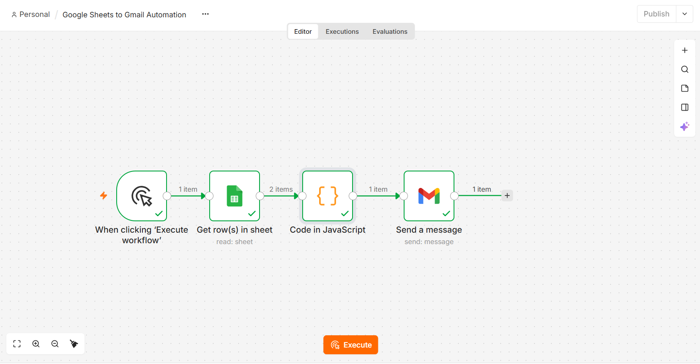
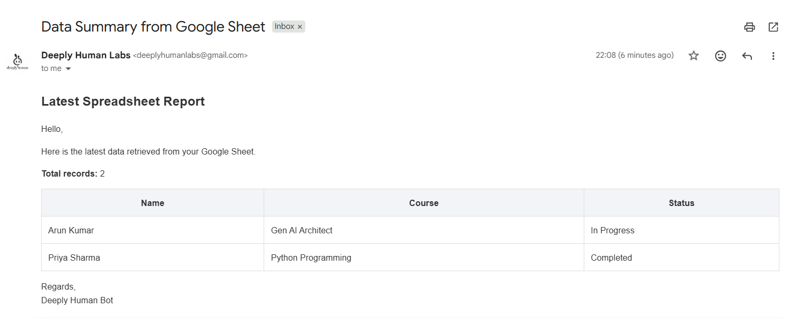

# Google Sheets to Gmail Automation with n8n

An n8n workflow that reads records from Google Sheets, formats them into a readable HTML email, and sends the summary through Gmail. The workflow supports multiple spreadsheet rows and avoids sending an email when the sheet contains no data rows.

## Demo

<video src="https://github.com/user-attachments/assets/2bf55e47-25f3-486f-989d-d4c92bc54da9" controls muted playsinline width="100%"></video>

## Screenshots

  
  

## Features

- Reads rows from a Google Sheet using the Google Sheets node.
- Builds an email subject and HTML body from the retrieved records.
- Displays the records in a structured table with a total record count.
- Sends the formatted message through Gmail.
- Handles an empty sheet without sending a blank email.
- Uses n8n-managed credentials for Google Sheets and Gmail.

## Workflow

1. **Manual Trigger** - starts the workflow on demand.
2. **Google Sheets - Get Row(s)** - retrieves records from the selected spreadsheet tab.
3. **Code (JavaScript)** - creates the email subject and HTML body, including a record count and formatted table.
4. **Gmail - Send a message** - sends the generated email to the configured recipient.

## Requirements

- An n8n instance (this workflow was built with n8n 2.35.7).
- A Google account with access to Google Sheets.
- Gmail access for sending the email.
- Google Sheets and Gmail credentials configured in n8n.

## Setup

1. Import `Google Sheets to Gmail Automation.json` into your n8n instance.
2. Open the Google Sheets node and select your Google Sheets credential, spreadsheet, and sheet tab.
3. Open the Gmail node and select your Gmail OAuth2 credential.
4. Set the recipient in the Gmail node's **To** field.
5. Confirm the Code node's expected column names match the spreadsheet headers:
   - `Name`
   - `Course`
   - `Status`
6. Save the workflow.

### Google OAuth credentials

Configure Google Sheets and Gmail authentication in n8n. For Gmail OAuth2, the Google Cloud OAuth client must include the redirect URI shown in the n8n credential configuration. Keep client secrets and tokens private; never commit them to the repository.

## Usage

1. Ensure the Google Sheet has the headers `Name`, `Course`, and `Status`.
2. Add one or more data rows.
3. Open the workflow in n8n and click **Execute workflow**.
4. Check the execution results and confirm the email arrives at the configured recipient.
5. To test empty-sheet handling, temporarily remove all data rows while keeping the header row, then execute the workflow. No email should be sent when there are no records.

## Example email

**Subject:** Data Summary from Google Sheet

The email body includes a heading, a short introduction, the total number of records, and an HTML table containing the spreadsheet data.

## Configuration notes

- The spreadsheet document and sheet tab are selected in the Google Sheets node.
- The recipient address is configured in the Gmail node.
- The Code node uses the spreadsheet field names `Name`, `Course`, and `Status`; update the code if your headers differ.
- Credentials are stored in n8n and should not be embedded in the exported workflow or committed to GitHub.

## Limitations

- The workflow expects the `Name`, `Course`, and `Status` columns.
- The workflow uses a predefined email template rather than an LLM-generated message.
- The workflow starts manually; it is not scheduled to run automatically.

## Project files

- `Google Sheets to Gmail Automation.json` - exported n8n workflow.
- `demo/workflow.png` - workflow screenshot.
- `demo/email.png` - screenshot of the received email.
- `demo/Gmail-Automation-Demo-Google-Sheets.mp4` - local demo recording, if you choose to include it in the repository.

## Security

Do not commit OAuth client secrets, access tokens, API keys, or other credentials. Review the exported workflow JSON before pushing it to GitHub to ensure it does not contain sensitive credential data.
